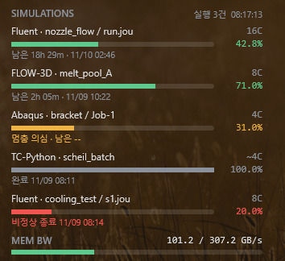

[한국어](README.md) · **English** · [日本語](README.ja.md) · [简体中文](README.zh.md) · [繁體中文](README.zh-TW.md)

# SimMonitor

A Windows program that shows how far your simulations have progressed on the desktop and notifies you on Telegram when they finish or stop.

**Supported programs:** Ansys Mechanical · Ansys Fluent · Abaqus · OpenFOAM (Windows builds) · FLOW-3D · Thermo-Calc (TC-Python)

**What it shows:** CPU cores in use, progress, remaining time, expected finish time

## Install

1. Download the [latest installer](https://github.com/ColorSkopar/SimMonitor/releases/latest) (`SimMonitorSetup-<version>.exe`) and run it.
2. Choose a language and click Next. No administrator rights are needed.

If "Windows protected your PC" appears, click "More info" → "Run anyway". It appears because this is an unsigned program by an individual developer.

## Telegram notifications (optional)

Connect them in the settings window that opens at the end of setup. In Telegram, send `/newbot` to BotFather to create a bot, then paste the token into the settings window. Chapter 4 of the manual has the detailed steps.

Notifications: scheduled status reports (interval adjustable), simulation completed, failed, possibly stalled.

## User manual

Illustrated manuals. After installation, the manual also opens from the Start menu (**SimMonitor User Manual**).

| Language | File |
|---|---|
| 한국어 | [SimMonitor-Manual-ko.pdf](docs/SimMonitor-Manual-ko.pdf) |
| English | [SimMonitor-Manual-en.pdf](docs/SimMonitor-Manual-en.pdf) |
| 日本語 | [SimMonitor-Manual-ja.pdf](docs/SimMonitor-Manual-ja.pdf) |
| 简体中文 | [SimMonitor-Manual-zh.pdf](docs/SimMonitor-Manual-zh.pdf) |
| 繁體中文 | [SimMonitor-Manual-zh-TW.pdf](docs/SimMonitor-Manual-zh-TW.pdf) |

## Safe to use

- Simulation files are only read; the program never stops or slows your simulations.
- The only data sent over the internet is the Telegram messages.
- The bot token is stored only inside your user folder and never shown on screen or written to logs.

## Terms of use

Free for personal and academic use. For company use, please contact us via [Issues](https://github.com/ColorSkopar/SimMonitor/issues). Full terms: [LICENSE](LICENSE).

Problems? Open an [issue](https://github.com/ColorSkopar/SimMonitor/issues). If SimMonitor helps you, you can [sponsor](https://github.com/sponsors/ColorSkopar) the project.
