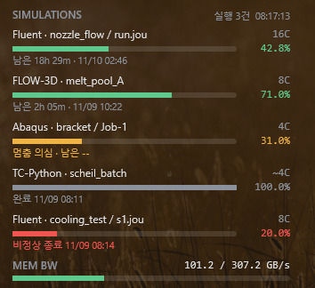

[한국어](README.md) · [English](README.en.md) · **日本語** · [简体中文](README.zh.md) · [繁體中文](README.zh-TW.md)

# SimMonitor

解析がどこまで進んだかをデスクトップに表示し、終わったり止まったりしたら Telegram でお知らせする Windows プログラムです。

**対応プログラム:** Ansys Mechanical · Ansys Fluent · Abaqus · OpenFOAM (Windows 版) · FLOW-3D · Thermo-Calc (TC-Python)

**表示する情報:** 使用中の CPU コア数、進捗、残り時間、終了予定時刻

## インストール

1. [最新のインストーラー](https://github.com/ColorSkopar/SimMonitor/releases/latest)（`SimMonitorSetup-<バージョン>.exe`）をダウンロードして実行します。
2. 言語を選んで [次へ] を押すだけで完了します。管理者権限は不要です。

「Windows によって PC が保護されました」と表示されたら、「詳細情報」→「実行」を押してください。個人が作成した未署名のプログラムのため表示されます。

## Telegram 通知（任意）

インストール最後に開く設定ウィンドウで接続します。Telegram で BotFather に `/newbot` を送ってボットを作り、受け取ったトークンを設定ウィンドウに貼り付けるだけです。詳しい手順はマニュアルの第 4 章にあります。

通知の種類: 定時レポート（間隔を変更可能）、解析の完了、異常終了、停止の疑い。

## マニュアル

図入りのマニュアルです。インストール後はスタートメニューの **SimMonitor マニュアル** からも開けます。

| 言語 | ファイル |
|---|---|
| 한국어 | [SimMonitor-Manual-ko.pdf](docs/SimMonitor-Manual-ko.pdf) |
| English | [SimMonitor-Manual-en.pdf](docs/SimMonitor-Manual-en.pdf) |
| 日本語 | [SimMonitor-Manual-ja.pdf](docs/SimMonitor-Manual-ja.pdf) |
| 简体中文 | [SimMonitor-Manual-zh.pdf](docs/SimMonitor-Manual-zh.pdf) |
| 繁體中文 | [SimMonitor-Manual-zh-TW.pdf](docs/SimMonitor-Manual-zh-TW.pdf) |

## 安心して使える理由

- 解析ファイルは読み取るだけで、解析プログラムを止めたり遅くしたりしません。
- インターネットに送るのは Telegram のメッセージだけです。
- ボットのトークンはユーザーフォルダー内にのみ保存され、画面やログには出ません。

## 利用条件

個人・学術用途は無料です。会社の業務で使う場合は [Issues](https://github.com/ColorSkopar/SimMonitor/issues) からお問い合わせください。詳しい条件は [LICENSE](LICENSE) にあります。

問題があれば [Issues](https://github.com/ColorSkopar/SimMonitor/issues) に書いてください。役に立ったら[支援](https://github.com/sponsors/ColorSkopar)もできます。
