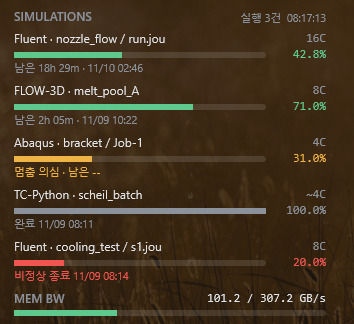

**한국어** · [English](README.en.md) · [日本語](README.ja.md) · [简体中文](README.zh.md) · [繁體中文](README.zh-TW.md)

# SimMonitor

해석이 얼마나 진행됐는지 바탕화면에 보여 주고, 끝나거나 멈추면 텔레그램으로 알려 주는 Windows 프로그램입니다.

**지원 프로그램:** Ansys Mechanical · Ansys Fluent · Abaqus · OpenFOAM (Windows 판) · FLOW-3D · Thermo-Calc (TC-Python)

**보이는 정보:** 쓰는 CPU 코어 수, 진행률, 남은 시간, 끝나는 예상 시각

## 설치

1. [최신 설치 파일](https://github.com/ColorSkopar/SimMonitor/releases/latest)(`SimMonitorSetup-<버전>.exe`)을 내려받아 실행합니다.
2. 언어를 고르고 [다음]만 누르면 끝납니다. 관리자 권한은 필요 없습니다.

"Windows의 PC 보호" 창이 뜨면 [추가 정보] → [실행]을 누르세요. 서명하지 않은 개인 제작 프로그램이라 뜨는 창입니다.

## 텔레그램 알림 (선택)

설치 마지막에 열리는 설정 창에서 연결합니다. 텔레그램에서 BotFather에게 `/newbot`을 보내 봇을 만들고, 받은 토큰을 설정 창에 붙여 넣으면 됩니다. 자세한 순서는 사용 설명서 4장에 있습니다.

알림은 정시 현황(간격 조절 가능), 해석 완료, 오류, 멈춤 의심입니다.

## 사용 설명서

그림이 있는 설명서입니다. 설치하면 시작 메뉴 **SimMonitor 사용 설명서**로도 열립니다.

| 언어 | 파일 |
|---|---|
| 한국어 | [SimMonitor-Manual-ko.pdf](docs/SimMonitor-Manual-ko.pdf) |
| English | [SimMonitor-Manual-en.pdf](docs/SimMonitor-Manual-en.pdf) |
| 日本語 | [SimMonitor-Manual-ja.pdf](docs/SimMonitor-Manual-ja.pdf) |
| 简体中文 | [SimMonitor-Manual-zh.pdf](docs/SimMonitor-Manual-zh.pdf) |
| 繁體中文 | [SimMonitor-Manual-zh-TW.pdf](docs/SimMonitor-Manual-zh-TW.pdf) |

## 안심하고 쓸 수 있는 이유

- 해석 파일은 읽기만 하고, 해석 프로그램을 멈추거나 느리게 하지 않습니다.
- 인터넷으로 보내는 것은 텔레그램 메시지뿐입니다.
- 봇 토큰은 내 사용자 폴더 안에만 저장되고 화면이나 기록에 쓰이지 않습니다.

## 사용 조건

개인·학술 용도는 무료입니다. 회사 업무에 쓰려면 [Issues](https://github.com/ColorSkopar/SimMonitor/issues)로 문의해 주세요. 전체 조건은 [LICENSE](LICENSE)에 있습니다.

문제가 있으면 [Issues](https://github.com/ColorSkopar/SimMonitor/issues)에 남겨 주세요. 도움이 됐다면 [후원](https://github.com/sponsors/ColorSkopar)할 수 있습니다.
