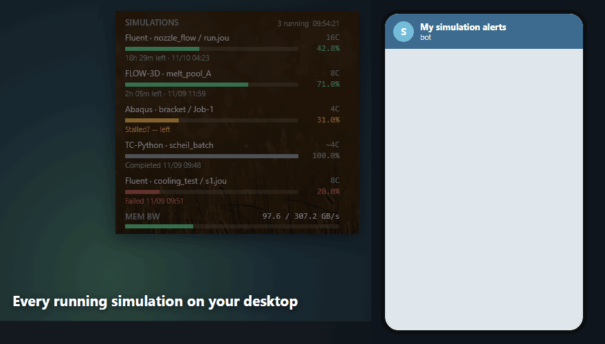

[한국어](README.md) · [English](README.en.md) · [日本語](README.ja.md) · [简体中文](README.zh.md) · **繁體中文**

# SimMonitor

一個 Windows 程式，會在桌面上顯示模擬的進度，並在模擬結束或停止時透過 Telegram 通知您。

**支援的程式：** Ansys Mechanical · Ansys Fluent · Abaqus · OpenFOAM (Windows 版) · FLOW-3D · Thermo-Calc (TC-Python)

**顯示的資訊：** 使用的 CPU 核心數、進度、剩餘時間、預計結束時間

## 安裝

1. 下載[最新安裝程式](https://github.com/ColorSkopar/SimMonitor/releases/latest)（`SimMonitorSetup-<版本>.exe`）並執行。
2. 選擇語言，按一下 [下一步] 即可完成。不需要系統管理員權限。

如果出現「Windows 已保護您的電腦」，請按一下「其他資訊」→「仍要執行」。這是因為本程式由個人開發且未經簽章。

## Telegram 通知（選用）

在安裝結束時開啟的設定視窗中連線。在 Telegram 中傳送 `/newbot` 給 BotFather 建立機器人，然後把收到的權杖貼到設定視窗即可。詳細步驟請參閱使用手冊第 4 章。

通知內容：定時狀態報告（可調整間隔）、模擬完成、異常終止、疑似停滯。

## 使用手冊

附圖的使用手冊。安裝後也可以從開始功能表的 **SimMonitor 使用手冊** 開啟。

| 語言 | 檔案 |
|---|---|
| 한국어 | [SimMonitor-Manual-ko.pdf](docs/SimMonitor-Manual-ko.pdf) |
| English | [SimMonitor-Manual-en.pdf](docs/SimMonitor-Manual-en.pdf) |
| 日本語 | [SimMonitor-Manual-ja.pdf](docs/SimMonitor-Manual-ja.pdf) |
| 简体中文 | [SimMonitor-Manual-zh.pdf](docs/SimMonitor-Manual-zh.pdf) |
| 繁體中文 | [SimMonitor-Manual-zh-TW.pdf](docs/SimMonitor-Manual-zh-TW.pdf) |

## 可以放心使用

- 只讀取模擬檔案，不會停止或拖慢模擬程式。
- 透過網路傳送的只有 Telegram 訊息。
- 機器人權杖只儲存在您的使用者資料夾中，不會顯示在螢幕上或寫入記錄。

## 使用條款

個人和學術用途免費。公司業務使用請透過 [Issues](https://github.com/ColorSkopar/SimMonitor/issues) 與我們聯絡。完整條款請參閱 [LICENSE](LICENSE)。

使用心得或問題請發到 [Discussions](https://github.com/ColorSkopar/SimMonitor/discussions)，錯誤回報和功能建議請發到 [Issues](https://github.com/ColorSkopar/SimMonitor/issues/new/choose)。如能告訴我們在哪些模擬程式和版本上可以（或不能）正常使用，將非常有幫助。如果對您有幫助，歡迎[贊助](https://github.com/sponsors/ColorSkopar)。
