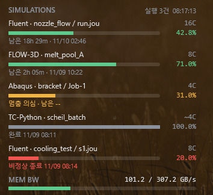

[한국어](README.md) · [English](README.en.md) · [日本語](README.ja.md) · **简体中文** · [繁體中文](README.zh-TW.md)

# SimMonitor

一个 Windows 程序，在桌面上显示仿真的进度，并在仿真结束或停止时通过 Telegram 通知你。

**支持的程序：** Ansys Mechanical · Ansys Fluent · Abaqus · OpenFOAM (Windows 版) · FLOW-3D · Thermo-Calc (TC-Python)

**显示的信息：** 使用的 CPU 核数、进度、剩余时间、预计结束时间

## 安装

1. 下载[最新安装程序](https://github.com/ColorSkopar/SimMonitor/releases/latest)（`SimMonitorSetup-<版本>.exe`）并运行。
2. 选择语言，点击 [下一步] 即可完成。不需要管理员权限。

如果出现“Windows 已保护你的电脑”，请点击“更多信息”→“仍要运行”。这是因为该程序由个人开发且未签名。

## Telegram 通知（可选）

在安装结束时打开的设置窗口中连接。在 Telegram 中向 BotFather 发送 `/newbot` 创建机器人，然后把收到的令牌粘贴到设置窗口即可。详细步骤见用户手册第 4 章。

通知内容：定时状态报告（可调整间隔）、仿真完成、异常终止、疑似停滞。

## 用户手册

带图的用户手册。安装后也可以从开始菜单的 **SimMonitor 用户手册** 打开。

| 语言 | 文件 |
|---|---|
| 한국어 | [SimMonitor-Manual-ko.pdf](docs/SimMonitor-Manual-ko.pdf) |
| English | [SimMonitor-Manual-en.pdf](docs/SimMonitor-Manual-en.pdf) |
| 日本語 | [SimMonitor-Manual-ja.pdf](docs/SimMonitor-Manual-ja.pdf) |
| 简体中文 | [SimMonitor-Manual-zh.pdf](docs/SimMonitor-Manual-zh.pdf) |
| 繁體中文 | [SimMonitor-Manual-zh-TW.pdf](docs/SimMonitor-Manual-zh-TW.pdf) |

## 可以放心使用

- 只读取仿真文件，不会停止或拖慢仿真程序。
- 通过网络发送的只有 Telegram 消息。
- 机器人令牌只保存在你的用户文件夹中，不会显示在屏幕上或写入日志。

## 使用条款

个人和学术用途免费。公司业务使用请通过 [Issues](https://github.com/ColorSkopar/SimMonitor/issues) 联系我们。完整条款见 [LICENSE](LICENSE)。

遇到问题请在 [Issues](https://github.com/ColorSkopar/SimMonitor/issues) 留言。如果对你有帮助，欢迎[赞助](https://github.com/sponsors/ColorSkopar)。
